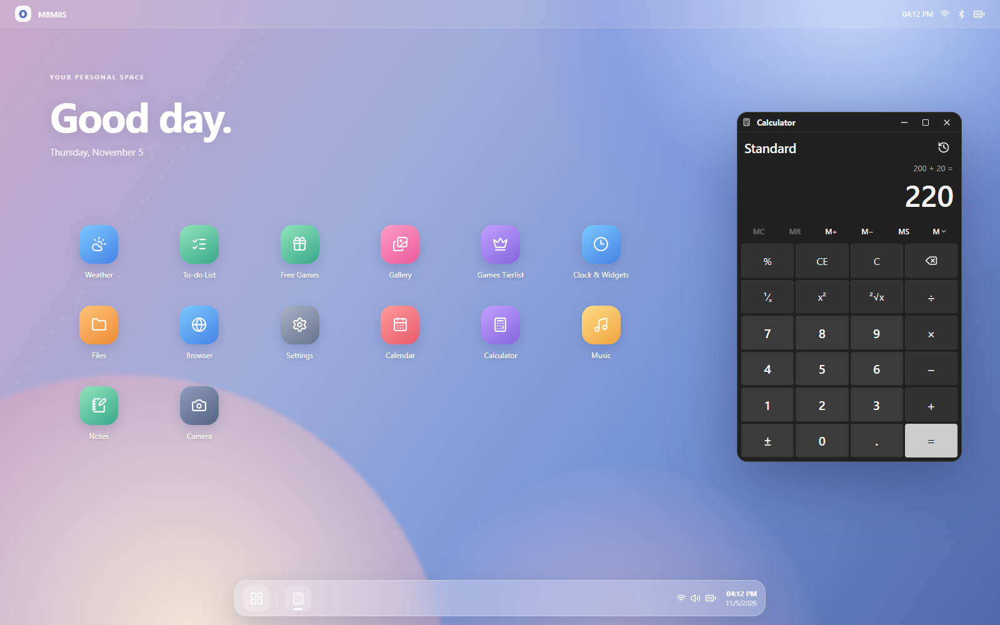

# M8M8S · Your Personal Space

A desktop-style website with everyday apps, game discoveries, and a home screen you can make your own. Open apps in movable windows on a desktop, or use the responsive layout on a phone or tablet.

**[Open M8M8S](https://galeravanrj-sys.github.io/oxygen-desktop/)** · [Deployment status](https://github.com/galeravanrj-sys/oxygen-desktop/actions)

**[Download the Android APK](https://github.com/galeravanrj-sys/oxygen-desktop/releases)** — ARM64 preview for Android 7.0+. Install instructions and checksums are included with each release.



## Inside M8M8S

| App | What you can do |
| --- | --- |
| Notifications | A dedicated history page with New, Today, and Earlier groups, announcement details, read status, and preferences in Settings. |
| Community Chat | Public General, Gaming, and Help rooms; sign in to send messages, delete your own posts, and receive live updates. Requires the chat database migration. |
| Daily Briefing | Bring together your saved city’s weather, tasks, today’s events, current giveaways, ranking changes, and games you’re playing. |
| Gaming Passport | Keep a personal Wishlist, Owned, Playing, and Finished library, with ratings, notes, and JSON export. Save giveaways to your wishlist from Free Games. |
| Theme Studio | Preview accent colors, icon shapes, backgrounds, and window transparency, with appearance reset that preserves app order and favorites. |
| Weather | Search for a city, check current conditions, and view a seven-day forecast. |
| To-do List | Create tasks, set due dates, check off completed work, and filter your list. |
| Free Games | Discover full-game giveaways for Steam, Epic Games, GOG, and itch.io, with store filters and links to offer details. |
| Gallery | Keep private photos on your device, browse community photos, and move through images with buttons or arrow keys. |
| Games Tierlist | Browse cached rankings for Zenless Zone Zero, Genshin Impact, Seven Deadly Sins: Origin, Honkai: Star Rail, and Seven Deadly Sins: Grand Cross. |
| Clock & Widgets | See the time, date, saved-photo count, and shortcuts to Gallery and Calendar. |
| Files | Upload small files, create folders, search, rename, copy, move, and download items. |
| Browser | Open websites in tabs, use back/forward and reload, and save bookmarks. |
| Settings | Choose a color theme, upload a wallpaper, rearrange home-screen apps, and pin favorites to the taskbar. |
| Calendar | Browse a month view and save events against individual dates. |
| Calculator | Use a dark Windows-style Standard calculator with memory, saved history, percentages, square roots, keyboard input, and copy/paste. |
| Music | Build a playlist from your device, switch tracks, and keep listening while the app is minimized. |
| Notes | Write and search notes, see word counts, and export notes as text files. |
| Camera | Choose a camera, capture photos, and save them privately to Gallery or download them. |

### A desktop that feels personal

- All 18 apps are available from the home screen and launcher.
- Drag, resize, minimize, maximize, or arrange windows side by side on desktop.
- Use **Settings → Make it yours** for wallpapers and color themes.
- Reorder your apps with the arrows in Settings, and select stars to pin favorites.
- Music and Browser keep their contents when minimized; Calculator keeps its current calculation too. Camera releases its stream when its window is hidden or closed.
- Open the launcher with **Ctrl + Alt + L**.

## Games and live information

- **Free Games:** giveaway listings from [GamerPower](https://www.gamerpower.com/). Open an offer to check its claim deadline, region, account, and redemption requirements. A store may have no active offers.
- **Weather:** city search and forecasts from [Open-Meteo](https://open-meteo.com/). Forecast times use the selected city's time zone.
- **Tier lists:** Genshin, Origin, and Honkai: Star Rail rankings come from [Game8](https://game8.co/). Grand Cross uses the [Grand Cross Wiki general tier list](https://7dsgc.fandom.com/wiki/General_Tier_List), retrieved through its wiki API.
- The hosted tier-list backend uses Supabase functions and a private cache, with a daily refresh scheduled for **3:00 AM Philippine time**. If a source fails, the last successful rankings remain available and are marked stale.

## Update notifications

The bell in the top bar tracks changes to the five tier lists and new full-game giveaways from Steam, Epic Games, GOG, and itch.io. It shows unread updates, supports marking alerts as read, and opens the relevant game or offer when selected.

The first successful check establishes a baseline without generating old alerts. Tier-list alerts compare rankings, so an unchanged daily refresh does not create a notification. Checks run every five minutes while the website is open and visible, with a manual **Check now** option. Notifications and the last-seen baseline are saved in this browser; they are not push alerts and do not arrive while the site is closed. Each category can be paused from the bell’s notification settings.

Theme Studio changes appearance across the desktop and saves it in this browser. Daily Briefing reads your existing personal data without creating duplicate task or event lists. Saving a giveaway to Gaming Passport does not claim or purchase it.

## Your data

Most personal data stays in the browser you use: notes, tasks, events, bookmarks, calculator history, your Gaming Passport, small uploaded files, wallpaper preferences, app order, and favorites. Private Gallery photos use the browser's IndexedDB storage. These items do **not** automatically sync between devices, and clearing website data can remove them. Export or download anything you want to keep separately.

Camera captures and **Add photos** stay private on that device. Gallery's **Publish to everyone** action creates a separate public copy in Supabase after confirmation and subject to the configured access rules. Community photos are visible to other visitors.

Music files are not uploaded and remain available while the app is open; closing the app or refreshing the page removes that playlist. Files supports uploads up to **2 MB per file**, subject to available browser storage.

Some websites block embedded viewing or sign-in. Use **Open externally** in Browser for those sites. Camera access requires HTTPS or localhost and browser permission.

## Run locally

Use **Node.js 22** and npm, matching the GitHub deployment workflow.

```powershell
git clone https://github.com/galeravanrj-sys/oxygen-desktop.git
cd oxygen-desktop
npm ci
```

Create `.env.local` in the project folder with your Supabase project's public connection settings:

```dotenv
VITE_SUPABASE_URL=https://YOUR_PROJECT.supabase.co
VITE_SUPABASE_PUBLISHABLE_KEY=YOUR_PUBLISHABLE_KEY
```

Then start the development server:

```powershell
npm run dev
```

Open the URL printed in the terminal, normally `http://localhost:5173/oxygen-desktop/`.

Only public client configuration belongs in `VITE_` variables because it is included in the website build. Keep `.env.local` out of Git, and never place a service-role key, database password, or refresh token there.

### Build and preview

```powershell
npm run build
npm run preview
```

`npm run lint` runs the repository's ESLint checks.

## Publishing

GitHub Actions builds and deploys the website to **GitHub Pages** when `main` is updated. The workflow reads `VITE_SUPABASE_URL` and `VITE_SUPABASE_PUBLISHABLE_KEY` from GitHub repository variables.

The Vite base path is `/oxygen-desktop/`. Update it if you host the project at a different path.

Publishing the frontend does not provision the Supabase Gallery bucket, access policies, tier-list cache, secrets, or scheduled jobs. Those backend resources must be configured separately. The current hosted tier-list endpoints are specified in the frontend and must also be updated for an independent deployment.

## Built with

React · TypeScript · Vite · Supabase · react-rnd · Lucide icons · decimal.js

M8M8S runs inside a web browser. Its desktop interface does not provide direct access to your Windows folders or replace your operating system.

## Project folders

- `src/`: active website apps, styles, and shared logic.
- `public/`: website assets served by Vite.
- `supabase/`: backend functions and local CLI configuration.
- `docs/`: documentation and screenshots.
- `archive/legacy-desktop/`: older nested project, retained for reference.
- `backups/`: local recovery copies, excluded from Git. Dated `organized-*` folders include a move manifest.
- `tierlist-diagnostics/`: fixtures used by `install-m8m8s-tierlist.ps1`; keep them together.
- `dist/` and `node_modules/`: generated build output and installed dependencies.

Use the main `oxygen-desktop` folder for all development commands.

## Community Chat setup

The frontend uses the existing Supabase client and Auth session. Before chat can run, review and execute `supabase/migrations/20261105000100_community_chat.sql` once in the Supabase SQL Editor. Do not run an unreviewed full database push: this checkout also contains other backend work. This migration creates only chat messages, protected throttle state, policies, a trigger, and the Realtime publication entry. It does not change secrets, Gallery, existing tier-list tables, or Auth configuration.

Visitors can read the latest 60 messages per room. Email/password accounts can send; account creation follows your existing Supabase email-confirmation settings. Public posting is limited to one message per account every five seconds on the server. Users can delete their own messages; updates are not allowed. Administrators can remove abusive content in the Supabase Table Editor. The app refreshes every 15 seconds while visible if Realtime is unavailable. Display names are self-chosen, with a short account identifier beside them. Emails are never included in messages. Account sign-in/sign-out is shared with Gallery. Messages are public, not encrypted private conversations.

Before public launch, verify the migration, email sign-up/confirmation, and cross-account permissions in a test project. The frontend can be built without applying the migration; it shows a setup-required state until the backend is ready.

### Zenless Zone Zero rankings

Game8’s [agent tier list](https://game8.co/games/Zenless-Zone-Zero/archives/435685) supplies Overall, DPS, Stun, and Support rankings. The app preserves Game8’s T0/T1+/T1/T2/T3/T4 labels and supports agent search and ranking-change notifications. The daily refresh validates all four category tables before replacing the last successful cache. Deploy the updated `games-tierlist` and `games-tierlist-refresh` functions and apply the ZZZ cache migration before publishing this frontend change.

### Gallery auto-sync

Open Gallery windows receive a public Realtime change signal after uploads or deletions made through the website, then fetch the latest authorized Storage listing. Signals contain no photo contents, filenames, or account information. Changes made outside the website, missed signals, or unavailable Realtime are picked up by the 10-second fallback while the tab is visible; returning to the tab or reconnecting also refreshes. The list keeps the latest 100 public images and preserves its current photos on sync failures. Camera captures and Add photos remain private on the device until explicitly published. No new database tables, Storage policies, or secrets are required.

## Home widgets, search, ranking comparisons, and chat tools

- Open **Widgets** from the dock to view or add Tasks, Weather, and Giveaway countdowns in a separate panel. Select **Edit widgets** to move, resize, remove, or arrange cards; on phones widgets stack and the up-arrow changes their order. Widget controls never reserve space on the desktop app grid. Widget layout stays on this browser. Weather uses the city already selected in Weather. Giveaway clocks use explicit source offsets when present; otherwise the visible timezone selector defines the estimate (UTC by default). Check the giveaway page before claiming.
- Open **Global search** with Ctrl+K (Cmd+K on macOS) or the dock search button. It searches apps, full note text, tasks, and the Gaming Passport stored on this browser, and opens the matching item. Search text is not sent to a server.
- **What changed?** in each tier list compares the current rankings with the previous changed snapshot. Roles and categories are compared separately. The database keeps the previous successful payload only when tiers or role grids change; timestamp-only updates and failed refreshes do not replace history. History begins after the first changed refresh following migration, so no earlier history is fabricated.
- Chat adds same-room replies, toggleable thumbs-up/heart/game reactions, per-room unread counts, and private reports. Unread state is browser-local and separated by signed-in account; an actively focused chat marks the current room read only while scrolled to the bottom. Visitors cannot read reports or edit another account's reactions. The site owner reviews reports in Supabase Table Editor (community_reports). Deleting a parent message clears its reply references and removes dependent reactions/reports.

### Backend update required

Review and apply only these new migrations in order:

1. supabase/migrations/20261106000100_tier_history.sql
2. supabase/migrations/20261106000200_chat_features.sql

Then deploy only the updated games-tierlist reader. The existing daily refresher automatically records history through the database trigger. Existing chat text messages continue working without the chat tools migration; advanced tools show setup notices if unavailable. No secrets or existing Storage permissions need changing. Do not rerun previously applied migrations or push every unrelated backend file.

### Grand Cross LR Heroes

Open Games Tierlist → 7DS Grand Cross → LR Heroes for the LR-specific rankings from [Grand Cross Wiki](https://7dsgc.fandom.com/wiki/LR_HERO). The bundled snapshot preserves SSS, SS, S, A, and Collection, with hero search and links to individual guides. Its wiki update date and import date are displayed. This LR snapshot is versioned with the frontend; it is separate from the automatically refreshed General Tier List and does not require a backend migration or secret changes.

### Hideout Guides tier lists

Naruto Blazing includes PVE and Phantom Castle lists; Black Clover M includes PvP/PvE with class filtering. The supplied Black Clover page currently describes the UNDEAD revival server, which is disclosed in the app. Character variants, source tier labels, guide links, and snapshot import dates are preserved. The bundled Hideout data is updated with website deployments, separately from the daily five-game backend cache. No backend migration or secrets are needed.

## Android app

M8M8S also has a Tauri 2 Android project. Run `npm run android:doctor` to check local tools and `npm run android:build` for an ARM64 debug APK. See [Android setup and testing](docs/ANDROID.md). The web build remains separate and continues using GitHub Pages.
